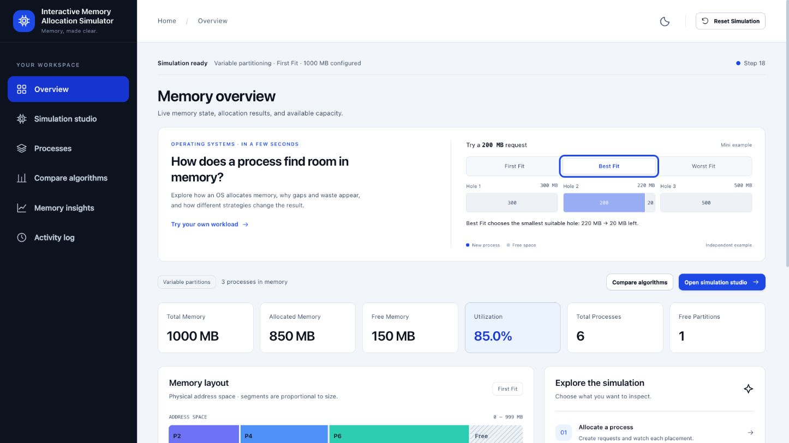
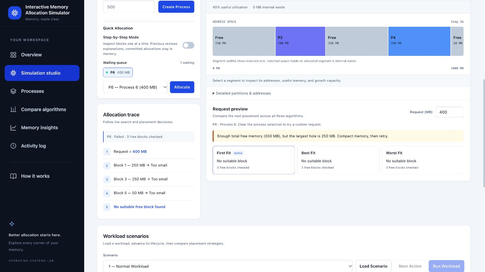
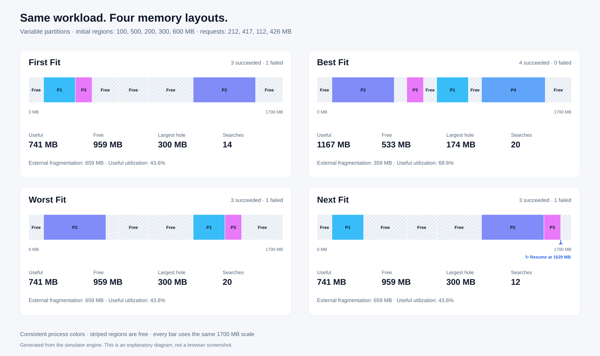

# Interactive Memory Allocation Simulator

**An interactive Operating Systems project for understanding contiguous memory allocation.**

See how **First Fit, Best Fit, Worst Fit, and Next Fit** place processes in memory. Follow each decision, discover why a request can fail despite available space, and use compaction to turn scattered holes into usable memory.

Built by **Umang Vekariya · Sarthak Dhawale · Aditya Khunt** using HTML, CSS, and JavaScript.

[Quick start](#quick-start) · [Features](#features) · [Try-a-demo](#try-a-demo) · [Project structure](#project-structure) · [Documentation](#documentation)

## Live demo

[Open the Interactive Memory Allocation Simulator](https://umang-vekariya.github.io/interactive-memory-allocation-simulator/)

Hosted on GitHub Pages. Updates pushed to this repository's `main` branch publish automatically.

## Preview

### Overview



### Fragmentation example



These screenshots are from earlier demonstration sessions. The current version also includes Next Fit, its visible search pointer, live metric explanations, and four comparison maps.

### Four-strategy comparison



This diagram is generated from the current memory engine, rather than captured from the browser. The app provides the same proportional layouts with expandable address tables on **Compare algorithms**.

## What this project demonstrates

An operating system needs to find a suitable contiguous region for each process. Different placement strategies can produce different layouts, search costs, and fragmentation—even with the same workload.

This simulator makes those decisions visible through a proportional memory map, process lifecycle records, step-by-step explanations, and independent algorithm comparisons. It supports **fixed and variable partitioning**.

> This is an educational simulation. It does not allocate real system RAM or interact with the operating-system kernel.

## Features

| Feature | What you can explore |
| --- | --- |
| Four allocation strategies | First Fit, Best Fit, Worst Fit, and Next Fit, including the free regions each strategy examines. |
| Fixed and variable partitions | Whole-partition reservation versus splitting free regions to match requests. |
| Process lifecycle | Create, allocate, grow, and release simulated processes. |
| Visible Next Fit pointer | Shows the saved resume address on the live memory map and in its comparison snapshot. |
| Live metric explanations | Explains useful utilization, internal waste, and external fragmentation with your current values. |
| Interactive memory map | Inspect addresses, reserved size, requested size, waste, and growth capacity. |
| Fragmentation and compaction | See scattered free space, merge adjacent holes, and compare addresses before and after compaction. |
| Step mode and playback | Walk through a placement decision, pause, review, and change playback speed. |
| Workload comparison | Replay the same actions on independent states and compare four proportional memory maps, address tables, success, utilization, fragmentation, and search effort. |
| Guided demos and scenarios | Follow a fragmentation lesson or experiment with five predefined workloads. |
| Request preview | Predict where a request would go under each strategy without allocating it. |
| Local saves and reports | Restore committed actions after refresh, import/export JSON workloads, and export a printable HTML report. |
| Responsive interface | Use light/dark themes and layouts that adapt to smaller screens. |

Overview also includes a small independent **200 MB request example**. Switch strategies to understand their placement rules before starting a full experiment.

## Quick start

### Option 1: run a local server

Clone the repository and enter its folder:

```sh
git clone https://github.com/Umang-Vekariya/interactive-memory-allocation-simulator.git
cd interactive-memory-allocation-simulator
```

Serve the files with Python 3:

```sh
python3 -m http.server 8001 --bind 127.0.0.1
```

Open **[http://127.0.0.1:8001/](http://127.0.0.1:8001/)** in your browser. Stop the server with `Ctrl+C` when finished. If the port is occupied, use another available port and open the matching address.

### Option 2: open offline

Open `index.html` directly in a modern browser. The application has no external runtime assets, package installation, build step, backend, or database dependency. A local server is recommended for consistent browser behavior.

**Requirements:** a modern browser; Python 3 for the optional local server; Node.js only if you want to run the automated checks.

## Try a demo

### Understand external fragmentation

1. Open **Simulation studio** and click **Start guided demo**. Loading a demo replaces the current workload after confirmation when applicable.
2. Advance the lesson using **Next stage**. Five processes initially fill **1,000 MB**.
3. Alternate releases leave **550 MB free**, but the largest hole is only **250 MB**.
4. A **400 MB** request fails because no single contiguous region can hold it.
5. Compact memory. Total free memory stays **550 MB**, and the largest hole becomes **550 MB**.
6. Retry the request. It succeeds, leaving **850 MB allocated** and **150 MB free**.

Inspect the failure record and compaction address changes to explain why the result changed.

### Compare placement strategies

Load the **Algorithm Comparison** scenario and run comparison. For its request sequence of **212, 417, 112, and 426 MB**, Best Fit places all four requests, while First Fit, Worst Fit, and Next Fit place three.

This example favors Best Fit; it does not mean Best Fit always wins. Different request sizes and release patterns can produce different outcomes.

### Demonstrate internal fragmentation

Choose **Fixed Partitioning**, configure partitions of **300 and 500 MB**, and allocate a **200 MB** process using First Fit. It reserves the 300 MB partition, leaving **100 MB of internal waste**.

## Allocation rules and metrics

| Strategy | Placement rule |
| --- | --- |
| First Fit | First free region large enough for the request. |
| Best Fit | Smallest free region large enough for the request. |
| Worst Fit | Largest free region large enough for the request. |
| Next Fit | First suitable region from its saved search position, wrapping to the beginning if needed. |

All four have worst-case **O(n)** search time with the current region-list representation. First Fit and Next Fit can stop early; Best Fit and Worst Fit examine all free regions.

| Metric | Definition |
| --- | --- |
| Reserved utilization | Reserved allocated memory ÷ total memory × 100. |
| Useful utilization | Requested memory of allocated processes ÷ total memory × 100. |
| Internal fragmentation | Sum of reserved size minus requested size for allocated processes. |
| External fragmentation | In variable mode: total free memory minus the largest free region. |
| Search effort | Number of free regions examined during allocation and growth attempts. |

In variable mode, allocation splits a hole, release coalesces adjacent holes, and compaction relocates allocated regions to combine free space. In fixed mode, partition boundaries remain unchanged, and compaction is disabled.

Comparisons use separate states with identical starting memory and lifecycle actions. The recommendation score is a project-specific metric, not a universal ranking:

```text
0.65 × success rate
+ 0.15 × useful utilization
+ 0.15 × (100 − external fragmentation ratio)
+ 5 × (1 − searches / max(maximum searches across algorithms, 1))
```

Rates and ratios use percentages; searches count examined free regions, not elapsed time.

## Project structure

```text
memory-allocation-simulator/
├── index.html                    # Pages, controls, and script loading order
├── README.md                     # Introduction, setup, and demos
├── css/
│   └── style.css                 # Styling, themes, and responsive layouts
├── js/
│   ├── app.js                    # Startup, controls, step mode, and comparison
│   ├── core/
│   │   ├── algorithms.js         # First Fit, Best Fit, Worst Fit, and Next Fit
│   │   └── memory-engine.js      # State, lifecycle, addresses, and statistics
│   └── interface/
│       ├── visualization.js      # Memory blocks, tables, history, and steps
│       ├── workspace.js          # Navigation, themes, and live overview
│       ├── analytics.js          # Charts, diagnostics, and compaction analysis
│       ├── dialogs.js            # Confirmation and memory-request dialogs
│       ├── block-inspector.js    # Selected block details and address snapshots
│       ├── scenarios.js          # Predefined workload controls
│       ├── studio-tools.js       # Waiting queue and request predictions
│       ├── lab-features.js       # Playback, saves, import/export, and reports
│       ├── learning-views.js     # Next Fit pointer, metric explanations, comparison maps
│       └── overview-demo.js      # Independent introductory allocation example
├── docs/
│   ├── images/                   # Images used by this README
│   ├── presentation/             # Final editable PowerPoint with presenter notes
│   ├── report/                   # Final documentation in Word and PDF
│   └── demo/                     # Final 15-page browser proof PDF and README
└── tests/
    └── simulator.test.js         # Automated regression checks
```

### How the parts connect

```text
User action → app.js → memory engine → allocation strategy
                           ↓
                    Updated memory state
                           ↓
               Interface renders the result
```

The core decides placement and changes state. The controller coordinates user actions. Interface files display the result and provide interactive features. CSS controls appearance. Scripts share the page scope and load in the dependency order specified in `index.html`; `app.js` loads last.

## Verification

From the project root:

```sh
node tests/simulator.test.js
```

The suite contains **48 regression checks**, including **4,000 deterministic mixed operations** checking memory invariants. Coverage includes algorithm selection, splitting, merging, growth, fixed-partition waste, failure diagnostics, compaction, workload replay, independent comparison, preview behavior, and single-commit step playback.

## Saved sessions and reports

Committed actions and configuration autosave locally in the browser. Refresh reconstructs the session by replaying them. Unfinished previews and playback reset, and comparison results should be rerun after loading or changing a workload.

Use **Save workload** to download JSON and **Load workload** to validate and replay a saved experiment. Use **Export report** to download a standalone HTML report, then open it and print or save as PDF. Browser-local storage is not an online account or shared database.

## Documentation

- **[PowerPoint presentation](docs/presentation/Interactive-Memory-Allocation-Simulator.pptx):** 14 slides with presenter notes; allow about 8–10 minutes.
- **[Project report (PDF)](docs/report/Interactive-Memory-Allocation-Simulator-Documentation.pdf)** and **[editable Word copy](docs/report/Interactive-Memory-Allocation-Simulator-Documentation.docx):** formal documentation and viva preparation.
- **[Browser proof (PDF)](docs/demo/Interactive-Memory-Allocation-Simulator-Browser-Proof.pdf):** 15 A4 landscape pages with website screenshots and a summary of 40 built-in scenario combinations.

Only `index.html`, `css/`, and `js/` are required to run the simulator. `docs/` contains submission material; `tests/` contains optional verification. `.nojekyll` supports GitHub Pages hosting, while `.gitignore` keeps local clutter out of version control.

## Scope

The model uses whole-MB simulated address offsets and contiguous regions. Variable growth uses only immediately following free space; fixed growth uses unused capacity inside the reserved partition. Initially configured variable regions remain independently selectable for textbook hole-list examples.

Paging, virtual memory, swapping, CPU scheduling, and real kernel operations are outside the current scope. Python only serves static files; all simulation calculations run in the browser.

## Project team

- **Umang Vekariya**
- **Sarthak Dhawale**
- **Aditya Khunt**

Developed as an **Operating Systems project**.

## Next Fit search position

Next Fit starts in the region containing its saved MB address and scans circularly. After a successful Next Fit allocation, the saved address becomes the end of the reserved region plus one (wrapping to zero at the end of memory). A leftover variable hole can therefore be used immediately by the next request; fixed mode resumes at the next partition.

Failed requests, previews, step review, releases, and algorithm switches do not advance the position. An address rather than a list index keeps the position valid when holes merge or blocks split. If merging places it inside a hole, the search considers that whole region. Configuration/reset and compaction reset it to zero. Saved workloads reconstruct the position through replay; each algorithm comparison has its own independent state.
